# AutoRFQ: Ferguson RFQ emails in, filled RFQ out

A sourcing manager gets RFQ emails that list product IDs: in the body, in an Excel attachment, mixed with
competitor part numbers, or buried in a forwarded thread. Copying each product's specs into the RFQ
template by hand takes hours. AutoRFQ reads the email, looks every item up, fills
`templates/rfq_template.xlsx` with a source for every value, checks the result, and replies in the same
email thread, usually in under a minute.

- **Base flow (no AI):** same email in, same Excel out. Email 1 matches `reference/email-1 reference output.xlsx`
  cell for cell, including all 105 Sources rows.
- **RFQ Quality Agent:** standardises units, flags missing or odd values, adds a Summary sheet, and holds
  doubtful RFQs for a person to approve. AI (Azure OpenAI) only adds advisory suggestions.
- **Web app:** runs, live progress, item cards with sources, keyboard review, approve & send.
- **Email bot:** answers RFQ emails in a Gmail inbox.

Spec: [`spec.md`](spec.md) · Plan: [`PLAN.md`](PLAN.md) · Features and diagrams: [`document.md`](document.md)

## Architecture

```mermaid
flowchart LR
    Gmail["Gmail inbox"] --> Bot["mailbot.py"]
    UI["React web app"] --> API["FastAPI app/"]
    Bot -->|subprocess| Build["rfq/build.py"]
    API -->|subprocess| Build
    Build --> Extract["extract: body, HTML,<br/>attachments, forwards"]
    Extract --> Lookup["look up: ferguson.com (Chrome CDP)<br/>→ spec sheet PDF → catalog"]
    Lookup --> Fill["fill RFQ + Sources + Notes"]
    Fill --> Quality["Quality Agent: units, rule flags,<br/>AI suggestions, Summary"]
    Quality --> Out["RFQ.xlsx · reply.eml · run.json"]
    Out -->|ready| Send["reply in thread"]
    Out -->|needs review| Review["review in web app"] --> Send
```



| Folder | What it is |
|---|---|
| `rfq/` | The core library. Stages: `extract/`, `sources/` (live, spec sheet, catalog, merge), `quality/`, `output/`, `review/`, `infra/` |
| `app/` | FastAPI: JSON API, SSE progress, approve & send; serves `web/dist` |
| `web/` | React + Vite + TypeScript + Tailwind, Ferguson palette, dark/light |
| `mailbot.py` | Gmail loop: replies, holds RFQs that need review, never loops on a bad email |
| `tests/` | 90 offline tests (pytest) + vitest |
| `data/spec_cache/` | Bundled spec sheet PDFs, the fallback when a download fails |

## Run it

Python 3.10+ and Node 20+. Commands for Linux/macOS; on Windows use `.venv\Scripts\python` and `py -3`.

```bash
python -m venv .venv            # Windows: py -3 -m venv .venv
.venv/bin/pip install -r requirements.txt
(cd web && npm ci && npm run build)
```

**One email:**

```bash
.venv/bin/python rfq/build.py emails/email-1-ids-in-body.eml --out out            # live: opens Chrome, closes it after
.venv/bin/python rfq/build.py emails/email-1-ids-in-body.eml --out out --offline  # catalog only, repeatable
```

This writes `out/<email name>/RFQ.xlsx`, `reply.eml`, `run.json` and `run.log`.

| Mode | Option | Sources used |
|---|---|---|
| Live | (default) | ferguson.com through a visible Chrome window (opened and closed for you; `--keep-browser` keeps it), then spec sheets, then the catalog |
| No browser | `--no-browser` | spec sheet PDFs (bundled copies if a download fails) and the catalog. Used on Azure |
| Offline | `--offline` | catalog only, no network. The tests and the reference use this |
| Replay | `--replay` | pages and PDFs cached by an earlier run, with no network |

**Web app:** `.venv/bin/python -m uvicorn app.main:app --port 8000`, then open http://127.0.0.1:8000.

**Email bot:** put `BOT_EMAIL` and `BOT_PASSWORD` (a Gmail App Password) in `.env`, then run
`.venv/bin/python mailbot.py`. It answers unread emails with "RFQ" in the subject.

**Optional AI review:** set `AZURE_OPENAI_ENDPOINT`, `AZURE_OPENAI_API_KEY` and `AZURE_OPENAI_DEPLOYMENT` in
`.env`.

**Checks:**

```bash
.venv/bin/python -m pytest                                    # 90 offline tests
.venv/bin/python .claude/skills/rfq-verify/check.py --build   # spec.md "Done when"
(cd web && npm test)
```

## Deploy to Azure

```bash
az login
.venv/bin/python scripts/deploy_azure.py --with-secrets
```

The script creates an App Service (Linux, Python 3.12, free F1 tier), deploys in `no-browser` mode (there's no
browser in the cloud), then runs the email-1 self-check against the live URL.

Live link: _added after the first deploy_.

## Limits

- **ferguson.com blocks headless and scripted browsers.** Live mode needs a visible Chrome window on the
  machine, so the cloud deployment uses spec sheets and the catalog instead.
- **Catalog prices date from 24 Sep 2026.** The reply labels them as list prices from that date.
- **Spec sheet reading is pattern based** (Thickness, ASTM, OSHA, Material). It only fills blank cells, and
  every disagreement goes to the Notes sheet.
- **The AI review is advisory.** It sees product data only, never the email, and it never changes a value
  or the status.
- **No user accounts.** The reviewer name is stored in the browser.
- **The brand colours are provisional.** They come from Ferguson Brand Connect's public theme; the
  guideline pages need a login.
