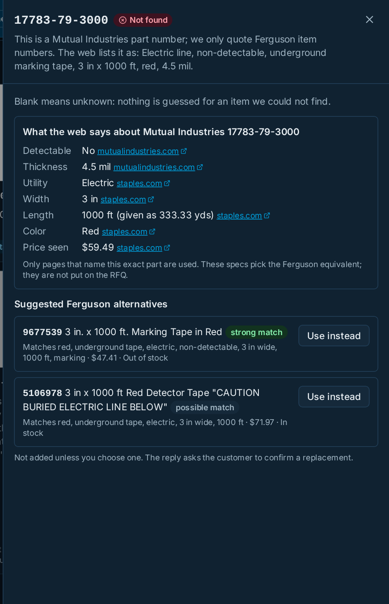

# AutoRFQ: Ferguson RFQ emails in, filled RFQ out

**Live:** [https://autorfq-live-f10b.happycoast-f8596a81.centralindia.azurecontainerapps.io](https://autorfq-live-f10b.happycoast-f8596a81.centralindia.azurecontainerapps.io) · upload page: [/rfq](https://autorfq-live-f10b.happycoast-f8596a81.centralindia.azurecontainerapps.io/rfq) · Diagnostics: [/diagnostics](https://autorfq-live-f10b.happycoast-f8596a81.centralindia.azurecontainerapps.io/diagnostics)

A sourcing manager gets RFQ emails that list product IDs: in the body, in an Excel attachment, mixed with
competitor part numbers, or buried in a forwarded thread. Copying each product's 23 specs into the RFQ
template by hand takes **2 to 4 days** per RFQ (about 40 a month across 6 countries). AutoRFQ reads the email,
looks every item up, fills `templates/rfq_template.xlsx` with a source for every value, checks the result, and
replies in the same email thread, usually in **about a minute**.

| | By hand | With AutoRFQ |
|---|---|---|
| Time to a finished RFQ | 2 to 4 days | ~1 minute, plus a quick look at the flagged cells |
| Finding the products | read every email, attachment and forward | text, Excel and forwards parsed; phone, PO and line numbers filtered out; duplicates kept once |
| Looking up 23 details each | ferguson.com one product at a time | ferguson.com, then the maker's spec sheet, then the product list; cached for 24 h |
| Mistakes (units, blanks, contradictions) | found by eye, if at all | found by code and flagged in the Excel; nothing is overwritten |
| Other brands' codes | look up and match by hand | competitor specs found online, Ferguson equivalents suggested |
| Where did this value come from? | unknown | a Sources sheet row for every value |

How it works, with diagrams: [`document.md`](document.md) · Presentation: [`Ferguson Agentic Fest Presentation Template.html`](Ferguson%20Agentic%20Fest%20Presentation%20Template.html)

## What it does

1. **Reads the request:** from the team Gmail inbox or the web upload page. Body, HTML, xlsx/csv attachments and
   forwarded threads; quoted replies are stripped.
2. **Looks every product up:** live ferguson.com page (a real Chrome kept hidden), then the maker's spec sheet
   PDF, then the catalog. A blank beats a guess.
3. **Fills Ferguson's RFQ template** plus **Summary**, **Sources** and **Notes** sheets. Email 1 matches
   `reference/email-1 reference output.xlsx` cell for cell, including all 105 Sources rows.
4. **Quality Agent:** standardises units, flags missing, placeholder, wrong-unit and contradicting values
   (grey, amber and orange cells with comments), and **holds doubtful RFQs** until a person approves. An AI model
   only adds advisory notes; code verifies each claim. It flags, it never overwrites.
5. **Competitor Product Finder:** a code like `Mutual 17783-79-3000` is looked up online (SerpApi) and matched to
   a Ferguson product; the reply offers it ("Reply "use 5106914""). Confirmed matches are remembered in the product
   database.
6. **Replies in the same thread** with `RFQ.xlsx` attached, or waits in the dashboard for **Approve & send**.



## The web app

| Page | What it is |
|---|---|
| **Runs** | every RFQ, from the inbox or uploaded, with status, found/flagged counts and a fill ring |
| **Run** | item cards with sources, the Agent findings, Notes & flags tab, Send reply / Approve & send, **Email RFQ…** to any address |
| **Review** | keyboard review of held RFQs: accept, undo, substitute a Ferguson alternative |
| **New RFQ** | upload an `.eml`, or try one of the four samples; pick live, no-browser or offline |
| **Diagnostics** | which settings are on (never their values), mail login test, who watches the inbox, self-check |
| **Sent mail** | the log of every email sent (replies, RFQ emails, notices): when, to whom, which run, sent or failed and why |
| **Admin** | shared product database (SQLite) with a Clear DB button (`ADMIN_TOKEN`) |

Dark theme by default with a light option; Ferguson palette (provisional: the Brand Connect guidelines need a login).

## Architecture

```mermaid
flowchart LR
    Gmail["Gmail inbox"] --> Bot["mailbot.py"]
    UI["React web app"] --> API["FastAPI app/"]
    Bot -->|subprocess| Build["rfq/build.py"]
    API -->|subprocess| Build
    Build --> Extract["extract: body, HTML,<br/>attachments, forwards"]
    Extract --> Lookup["look up: ferguson.com (Chrome CDP)<br/>→ spec sheet PDF → catalog"]
    Lookup --> Fill["fill RFQ + Sources + Notes"]
    Fill --> Quality["Quality Agent: units, rule flags,<br/>AI suggestions, Summary"]
    Quality --> Out["RFQ.xlsx · reply.eml · run.json"]
    Out -->|ready| Send["reply in thread"]
    Out -->|needs review| Review["review in web app"] --> Send
```



| Folder | What it is |
|---|---|
| `rfq/` | The core library. Stages: `extract/`, `sources/` (live, spec sheet, catalog, merge), `quality/`, `output/`, `review/`, `infra/` |
| `app/` | FastAPI: JSON API, SSE progress, approve & send; serves `web/dist` |
| `web/` | React + Vite + TypeScript + Tailwind, Ferguson palette, dark/light |
| `mailbot.py` | Gmail loop: replies, holds RFQs that need review, never loops on a bad email |
| `tests/` | 117 offline tests (pytest) + vitest |
| `data/spec_cache/` | Bundled spec sheet PDFs, the fallback when a download fails |

## Where files go

```text
out/                      (RFQ_OUT_DIR)
  runs/<run id>/          RFQ.xlsx, reply.eml, run.json, run.log, events.jsonl, review.json: one folder per RFQ
  inbox/                  emails received by the bot (.eml)
  uploads/                emails uploaded in the dashboard (.eml)
  db/products.db          product cache and competitor cross-references (Admin can clear it)
  db/mail.db              log of every email sent (never cleared by Clear DB)
  .cache/                 saved ferguson.com pages and spec sheet PDFs, for --replay
```

The app and the bot move an older flat `out/` into this layout on start (run folders into `runs/`, `products.db`
into `db/`). Sends recorded by older versions in `run.json` are imported into the mail log once.

## Run it

Python 3.10+ and Node 20+. Commands for Linux/macOS; on Windows use `.venv\Scripts\python` and `py -3`.

```bash
python -m venv .venv            # Windows: py -3 -m venv .venv
.venv/bin/pip install -r requirements.txt
(cd web && npm ci && npm run build)
```

**One email:**

```bash
.venv/bin/python rfq/build.py emails/email-1-ids-in-body.eml --out out            # live: opens Chrome, closes it after
.venv/bin/python rfq/build.py emails/email-1-ids-in-body.eml --out out --offline  # catalog only, repeatable
```

`build.py --out <folder>` writes `<folder>/<email name>/RFQ.xlsx`, `reply.eml`, `run.json` and `run.log`; the web app and the bot use `out/runs/` for it.

| Mode | Option | Sources used |
|---|---|---|
| Live | (default) | ferguson.com through a real Chrome that stays hidden (Xvfb virtual display on Linux, off-screen on Windows/macOS; `RFQ_SHOW_BROWSER=1` or `rfq/chrome.py --show` shows it). Opened and closed for you (`--keep-browser` keeps it), then spec sheets, then the catalog |
| No browser | `--no-browser` | spec sheet PDFs (bundled copies if a download fails) and the catalog. Used on Azure |
| Offline | `--offline` | catalog only, no network. The tests and the reference use this |
| Replay | `--replay` | pages and PDFs cached by an earlier run, with no network |

**Web app:** `.venv/bin/python -m uvicorn app.main:app --port 8000`, then open http://127.0.0.1:8000.

**Settings (`.env`):** copy `.env.example` to `.env` in the repo root and fill in what you use. `.env` is
git-ignored. One loader (`rfq/infra/env.py`) feeds it to `build.py`, `mailbot.py` and the web app, and the
Diagnostics page shows which keys are set (never their values).

| Key | For |
|---|---|
| `BOT_EMAIL`, `BOT_PASSWORD` | the team Gmail and its 16-letter **App Password** (Google Account → Security → 2-Step Verification → App passwords). Used by `mailbot.py` and by Approve & send |
| `OPENAI_API_KEY`, `OPENAI_MODEL` | the quality agent's LLM check (or `AZURE_OPENAI_ENDPOINT` / `_API_KEY` / `_DEPLOYMENT`) |
| `REVIEW_NOTIFY_EMAIL`, `DASHBOARD_URL` | optional "needs review" notice and its link |
| `SERPAPI_API_KEY` | optional web search for competitor codes with no description |
| `RFQ_OUT_DIR`, `RFQ_PRODUCTS_DB`, `RFQ_MAIL_DB` | where runs live, and the two databases (defaults: `out/`, `out/db/products.db`, `out/db/mail.db`) |

**Email bot:** with the mail keys set, the web app watches the inbox itself (every 30 s; `RFQ_INBOX_WATCH=0`
turns it off), and Diagnostics shows who watches it and when it last checked. `.venv/bin/python mailbot.py` does
the same without the web app; when it runs, the web app leaves the inbox to it. It answers unread emails from
today with "RFQ" in the subject or the text, sent from another address, in the same thread. RFQs that need review wait in the
dashboard until someone clicks Approve & send.

**Upload page:** http://127.0.0.1:8000/rfq (the same page runs on Azure, see Live above).

**Checks:**

```bash
.venv/bin/python -m pytest                                    # 117 offline tests
.venv/bin/python .claude/skills/rfq-verify/check.py --build   # acceptance checks (email 1 = reference, nothing dropped)
(cd web && npm test)
```

## Deploy to Azure

```bash
az login
.venv/bin/python scripts/deploy_azure.py --with-secrets
```

The script creates an **Azure Function App** (Python 3.12, Linux, consumption plan), as on Day 3:
- **`function_app.py`** wraps the FastAPI app, and **`host.json`** sets `routePrefix: ""`, so `/rfq`, `/`
  and `/api` keep their paths.
- **Settings:** `RFQ_MODE=no-browser` (there's no browser in the cloud) and `RFQ_OUT_DIR=/tmp/autorfq` (only
  /tmp is writable). `--with-secrets` copies the keys from `.env` into the app settings.
- **Requirements:** the zip leaves playwright out.
- **Check:** after deploying, it runs the email-1 self-check against the live URL.

**Live mode on Azure** (`--target container`): Functions can't run a browser, so this builds the `Dockerfile`
(the web app, the inbox watcher and Chromium on an invisible Xvfb display), pushes it to an Azure Container
Registry and runs it on **Azure Container Apps** (one always-on replica, 1 vCPU / 2 GiB, `RFQ_MODE=live`). Use
`--no-inbox` on the other deployment so only one of them answers the inbox. Locally:
`docker build -t autorfq . && docker run -p 8000:8000 --env-file .env autorfq`.

On Functions, the `inbox_timer` function in `function_app.py` checks the inbox every minute instead.

`--target webapp` uses App Service instead. If you see AADSTS50076/50079, sign in at portal.azure.com, set up
the Authenticator app, then run `az logout` and `az login`.

**What runs where:** everything runs on Azure: the container answers the inbox and looks up live pages; the
Function App is the no-browser fallback.

**Live link (container, live mode):** [https://autorfq-live-f10b.happycoast-f8596a81.centralindia.azurecontainerapps.io](https://autorfq-live-f10b.happycoast-f8596a81.centralindia.azurecontainerapps.io) · upload page: [/rfq](https://autorfq-live-f10b.happycoast-f8596a81.centralindia.azurecontainerapps.io/rfq).
It answers the team inbox, looks up live ferguson.com pages through the hidden Chrome and shows the review
dashboard. The earlier no-browser Function App, <https://autorfq-9b7e0b.azurewebsites.net>, stays up as a fallback
with inbox watching off. The email-1 self-check passes on both (6/6 rows, 105/105 sources).

## Limits

- **ferguson.com blocks headless browsers.** Live mode uses a real, headed Chrome on an invisible display
  instead; no fingerprint tricks. If the site refuses a page, that item falls back to spec sheets and the catalog.
- **Catalog prices date from 24 Sep 2026.** The reply labels them as list prices from that date.
- **Spec sheet reading is pattern based** (Thickness, ASTM, OSHA, Material). It only fills blank cells, and
  every disagreement goes to the Notes sheet.
- **Code vs model.** Units, blanks, placeholders, ranges, wrong units and description/application
  contradictions are plain code. The LLM only looks for what code can't see. Its flags are advisory: it sees
  product data only, never the email, and never changes a value or the status.
- **No user accounts.** The reviewer name is stored in the browser.
- **The brand colours are provisional.** They come from Ferguson Brand Connect's public theme; the
  guideline pages need a login.
