# Ferguson RFQ Automation: Features and Architecture

> Status: design document. It describes the system as planned in `PLAN.md` and `spec.md`. The parts are
> built in the order given at the end.

## 1. What the system does

Ferguson receives **RFQ (Request for Quote) emails**. Each one lists product IDs, which can appear in four
ways:

- in the email body;
- in an Excel attachment;
- mixed with competitor part numbers;
- buried inside a forwarded email.

The system turns each email into:

- a filled **`RFQ.xlsx`** built from `templates/rfq_template.xlsx`, with one row per product;
- a **Sources** sheet with one row per filled value, showing where it came from;
- a **Notes** sheet recording what happened to each item;
- a **Summary** sheet with the fill rate, quality flags and AI suggestions;
- a **reply email** (`reply.eml`) sent in the same thread as the request.

The base is deterministic: **same email in, same Excel out, every time.** AI is used only to make
suggestions. It never changes a value.

---

## 2. System architecture

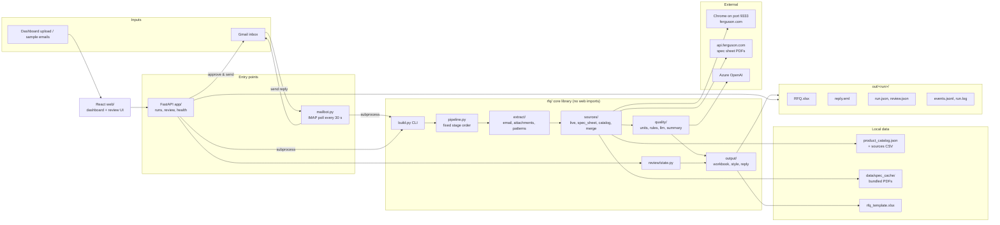

### Layers

| Layer | Folder | Responsibility |
|---|---|---|
| Core library | `rfq/` | Email → `RunResult` → files. Knows nothing about the web. |
| CLI shims | `rfq/build.py`, `rfq/chrome.py` | Fixed command-line contract used by `mailbot.py` and the deck. |
| Email bot | `mailbot.py` | Watches Gmail, runs a build per RFQ email, sends or holds the reply. |
| API | `app/` | FastAPI JSON API, SSE progress and the review actions. Serves `web/dist`. |
| Frontend | `web/` | React + Vite + TypeScript + shadcn/ui dashboard. |
| Tests | `tests/` | Offline unit and integration tests, run in CI on Linux and Windows. |

---

## 3. End-to-end flow of one RFQ email

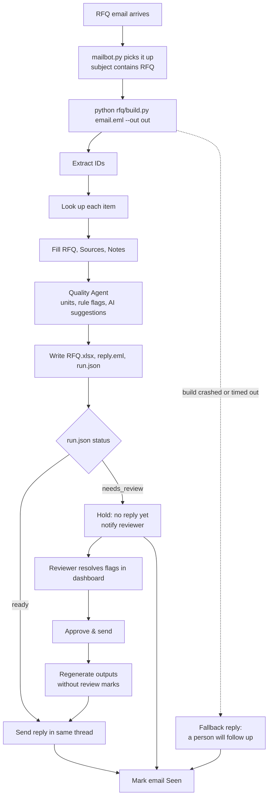

---

## 4. Pipeline stages in detail

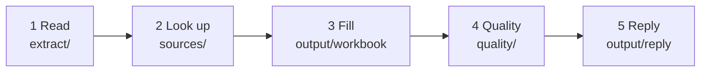

Each stage writes progress events to `events.jsonl`. The dashboard stepper is driven by these events over
SSE.

### 4.1 Extraction (`rfq/extract/`)

- **Text sources:**
  - every `text/plain` part, falling back to stripped HTML;
  - forwarded `message/rfc822` emails;
  - `.xlsx`, `.xlsm` and `.csv` attachments. In a sheet, the column whose header matches
    `item|product|sku|part|id` is used. If no header matches, any cell matching the ID pattern is used.
- **Ferguson IDs:** `(?<![\w-])#?(\d{5,7})(?![\w-])`. This handles `#5106926` and `1844552 , 4783795`,
  and ignores `x 40 rolls`.
- **Competitor codes:** hyphenated alphanumeric tokens (case-insensitive), e.g. `17783-79-3000`, `31-024`,
  `MTX-4409-XQ`. These are kept and reported as **Not found**.
- **Context filter:** a number right after `tel/phone/fax/zip/pin/po/order/invoice/qty` is skipped.
- **Order:** IDs keep their order of first appearance, and duplicates are dropped with a Note.
- **Limits:** at most 300 items, attachments up to 10 MB, and up to 5,000 rows per sheet.

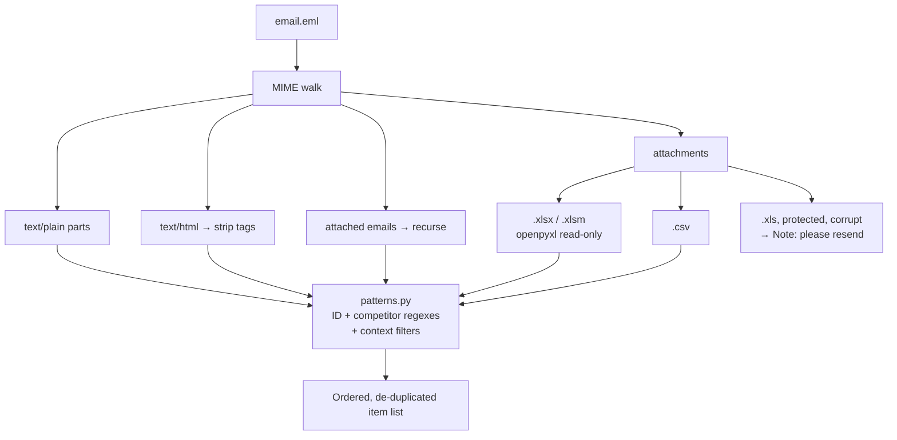

### 4.2 Lookup and fallback (`rfq/sources/`)

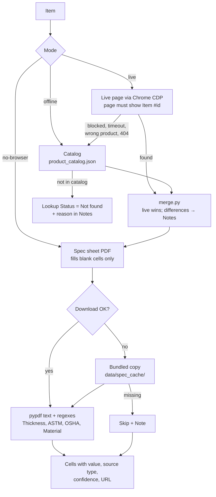

| Source | `source_type` | Confidence | Notes |
|---|---|---|---|
| Live ferguson.com page | `ferguson_page` | high | Up to 3 tabs in parallel; results re-sorted into email order. 8-minute live budget; stops after 3 blocks in a row. |
| Spec sheet PDF | `spec_sheet` | medium | Only fills blanks. Keeps the page number and text snippet. |
| Catalog | carried over from CSV | as given | Always available; used by `--offline` and as the fallback. |
| Human reviewer | `human_review` | high | Recorded with reviewer name and time. |

### 4.3 Run modes

| Mode | Flag | Sources used | Use |
|---|---|---|---|
| Live (default) | none | live page → spec PDF → catalog | Demo laptop with Chrome open |
| No browser | `--no-browser` | spec PDF (bundled fallback) → catalog | Azure, servers |
| Offline | `--offline` | catalog only, no network | Tests; reproduces the reference exactly |
| Replay | `--replay` | cached pages and PDFs from `out/.cache/` | Demo with bad Wi-Fi or a blocked site |
| No quality | `--no-quality` | skips Part B | Debugging |

### 4.4 Workbook output (`rfq/output/`)

- **RFQ sheet:**
  - one row per item in email order; all values are strings;
  - `Image` is the formula `=IMAGE("url")` and `Picture` is the URL;
  - `Lookup Status` is `Found` or `Not found`.
- **Sources sheet:** one row per filled cell, in template column order. Image and Picture reuse the picture
  source.
- **Notes sheet:** `product_id | note`, sorted by item, then by stage.
- **Summary sheet:**
  - KPIs, fill rate per column (bar chart) and the request lines with quantities;
  - risk alerts, the flags table and the AI suggestions table.
- **Styling (`style.py`):** formatting only, never a value change.
  - Branded header, frozen panes, autofilter.
  - A status colour together with text.
  - A confidence colour scale on Sources.
- **Safety:**
  - text starting with `=` stays text;
  - illegal characters are stripped;
  - the file is saved atomically, with a retry if it is locked in Excel.

---

## 5. Quality Agent (Part B)

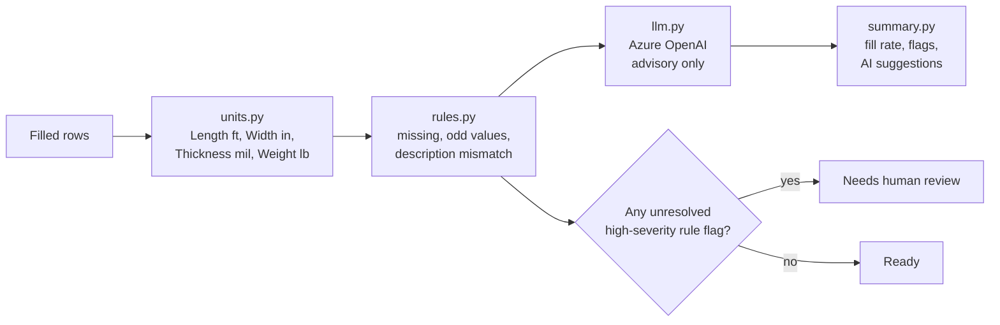

- **Unit normalisation:** a bare `1000` becomes `1000 ft`. The Sources row keeps its origin and adds "unit
  normalised", and every conversion gets a Note.
- **Rule flags:** each has a rule name and a severity. `high` is used only for probable errors: a missing
  key value on a Found row, or a description that contradicts Width, Length or Color.
- **LLM review:**
  - one call per found row, with only the row JSON and its sources (never the raw email);
  - structured output; a flag must quote the cell value it questions, or it is dropped;
  - **it never changes a value or the status**;
  - if the call fails or there are no credentials, it is skipped and the Summary says so.

---

## 6. Run status lifecycle

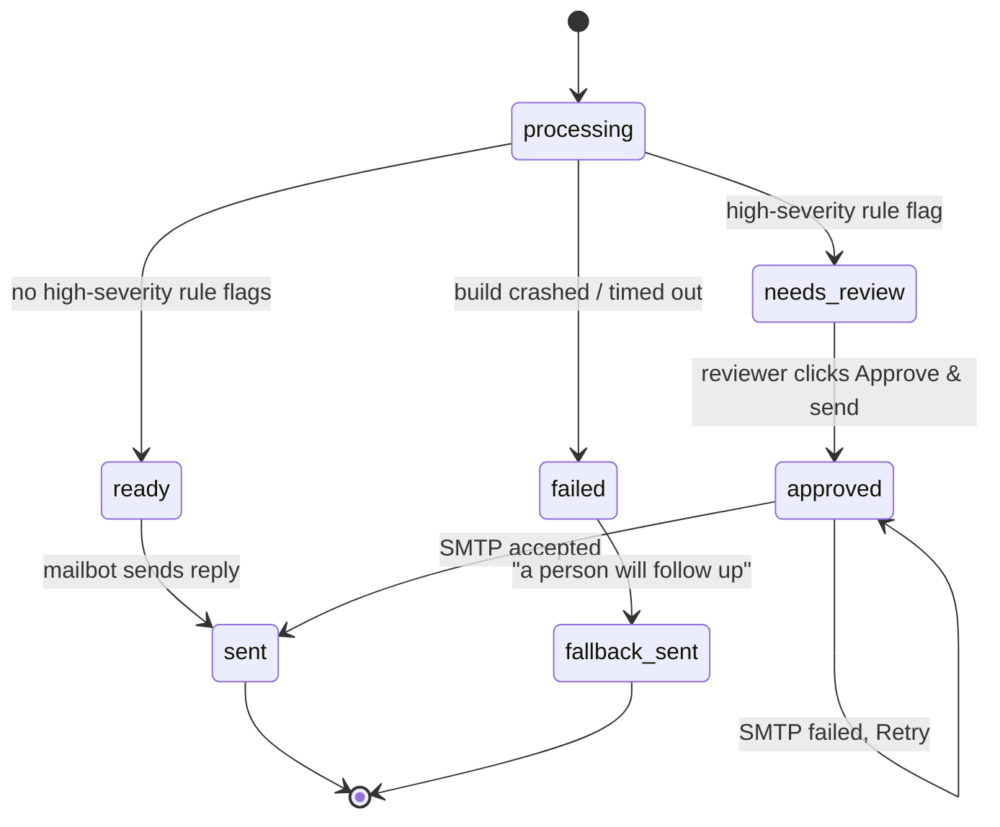

---

## 7. Human-in-the-loop review

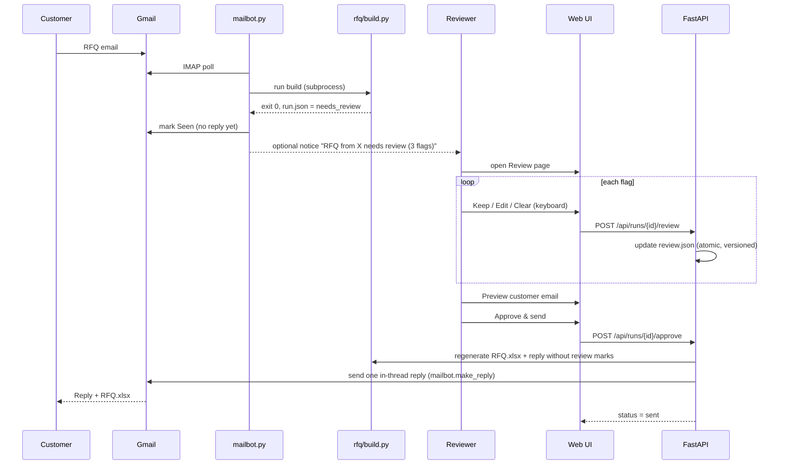

**Review page:**
- **Layout:** flags grouped by item, high severity first, with a "3 of 7 resolved" progress line.
- **Actions:** Keep value, Edit, or Clear (unknown). An edit or clear adds a `human_review` Sources row.
- **Keyboard:** ↑/↓ to move, Enter to keep, E to edit, Del to clear, Ctrl+Z to undo.
- **Approve & send:** disabled until every high-severity flag is resolved, and the button says why.

---

## 8. Dashboard and API

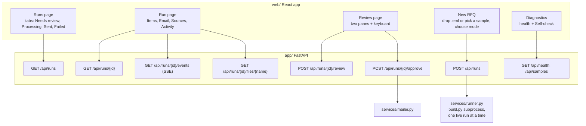

- **Health bar:** Chrome Connected/Offline · AI review On/Off · Inbox Watching/Off.
- **Item cards:** image, ID, description, status badge, source label, price · stock, flag count. Clicking a
  card opens a side sheet with every field and its source; spec values also show the PDF page and snippet.
- **Design rules:**
  - dark theme by default, with a light theme;
  - every status has an icon **and** text;
  - 150-200 ms fades only; reduced motion is respected;
  - WCAG AA contrast and full keyboard access.

---

## 9. Customer reply

The reply is multipart (HTML + plain text) with `RFQ.xlsx` attached. It contains:

- a summary line, e.g. "Your RFQ for 7 items is attached: 5 matched, 2 need your input.";
- a counts line, e.g. "Products found: 5 of 7. Not found: 2.";
- an item table: #, Item, Description, Status, Unit price, Availability;
- "Items we couldn't match", each with a reason and a next step, e.g. "Did you mean 9677531?";
- a quality line in buyer words, e.g. "Quality check: every value checked. 3 measurements converted to
  standard units (ft, in, mil, lb). 2 values are worth a second look; they are listed on the Summary
  sheet." (or "No issues found."; after a review: "Quality check: checked by our team.");
- "Every value's source is on the Sources sheet."

It **never** contains internal words (flag, rule, severity), fill rates, review links, the word "AI", or "DRAFT".

---

## 10. Failure handling

Principle: **a bad input or a broken source makes the RFQ smaller; it never makes the run fail.**

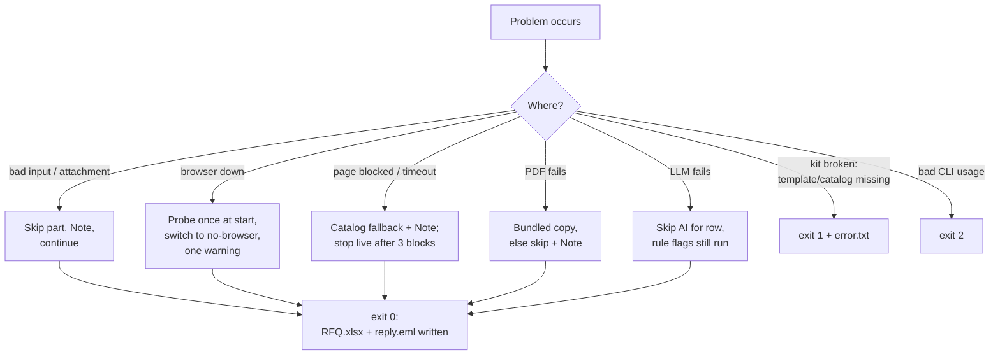

| Exit code | Meaning |
|---|---|
| `0` | RFQ.xlsx and reply.eml were written, possibly with warnings |
| `1` | The kit itself is broken (template or catalog) and nothing could be written |
| `2` | Usage error: missing `.eml` or bad flags |

**Mailbot hardening:**
- Each email is wrapped in try/except/finally.
- On failure, the bot sends the "a person will follow up" reply.
- The email is **always** marked `\Seen`, so one bad email can never block the inbox.

Problems are recorded in three places: the **Notes** sheet (the buyer sees it), **`run.log`** (warnings and
tracebacks), and the printed summary line (`warnings: N`).

---

## 11. Determinism guarantees

| Rule | How |
|---|---|
| AI is advisory | Status, highlights and reply wording come from rule flags only |
| Stable order | Parallel lookups are re-sorted into email order; Notes sorted by item, then stage |
| Spec PDFs | Bundled fallback copies make `--no-browser` repeatable |
| No timings in outputs | Timings appear only in the dashboard, console and `run.log` |
| Values, not bytes | Tests compare cell values; openpyxl timestamps may differ |
| Human edits | The only change allowed after the build, recorded as a `human_review` source |

---

## 12. Data model

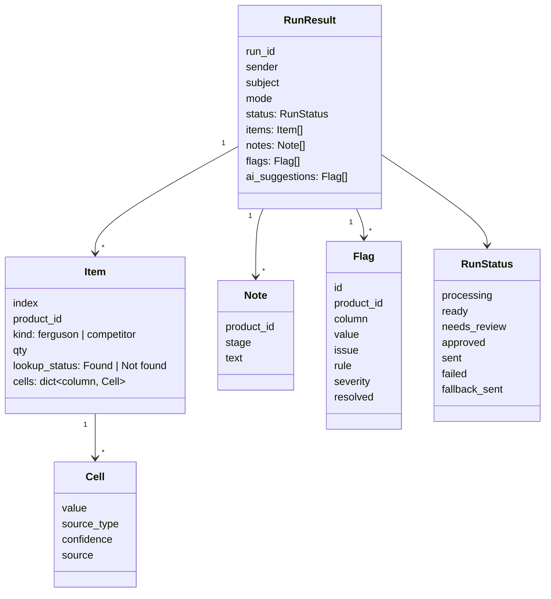

The same model is used by every pipeline stage, by `run.json`, and by the API (`app/schemas.py`
mirrors it).

---

## 13. Deployment

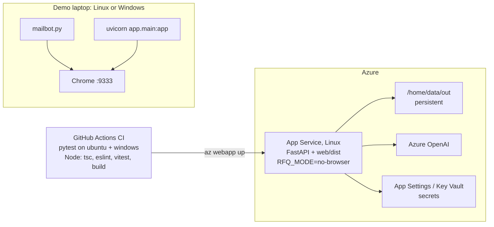

- **Cross-platform rules:**
  - `pathlib` paths built from `ROOT`, and explicit UTF-8 everywhere (`utf-8-sig` for the CSVs);
  - Windows-safe folder names, with atomic Excel saves and a lock retry;
  - a Chrome/Edge launcher in `rfq/chrome.py`.
- **Secrets** live in `.env` locally and in App Settings on Azure: `BOT_EMAIL`, `BOT_PASSWORD`,
  `AZURE_OPENAI_*`, `REVIEW_NOTIFY_EMAIL`, `DASHBOARD_URL`.

---

## 14. Extra features (ranked)

1. **Quantities and estimated quote value.** A request-lines table with line totals.
2. **Sourcing risk alerts.** Out of stock, stale catalog prices, discontinued or Not found items.
3. **"Did you mean…?"** For near-miss IDs. Only a suggestion, never substituted automatically.
4. **Compliance matrix.** ANSI / OSHA / ASTM / UL per product.
5. **Follow-up emails in the same thread.** "Also add 5106899" produces version 2 of the RFQ.
6. **More attachment types.** PDF item lists, and IDs in the subject line.
7. **Prompt-injection safety.** The LLM sees product data only, and every flag must quote its cell.
8. **Showcase extras:**
   - page cache + replay;
   - fill rate before vs after;
   - time saved;
   - one-click Self-check;
   - parallel tabs;
   - Ferguson alternatives for competitor parts.

---

## 15. Build order

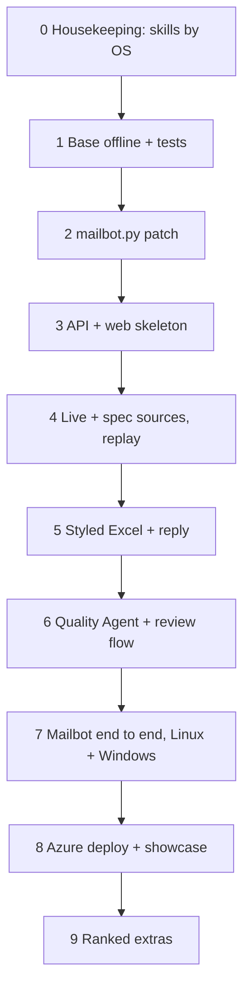

## 16. How correctness is checked

- **`test_reference`:** email 1 offline matches `reference/email-1 reference output.xlsx` cell for cell
  (6 rows, 105 Sources rows, status Ready).
- **`test_extract`:** the four expected ID lists. Unknown and competitor items show as Not found and are
  never dropped.
- **`test_determinism`, `test_failures`, `test_quality`:** repeatability, the broken-input fixtures, and the
  AI staying advisory.
- **`test_review_state`, `test_hold_flow`:** review decisions, and the hold → approve → reply path.
- **Web:** vitest unit tests and a Playwright end-to-end test of the review flow.
- **Skill:** `/rfq-verify` runs the acceptance checks from `spec.md`.
