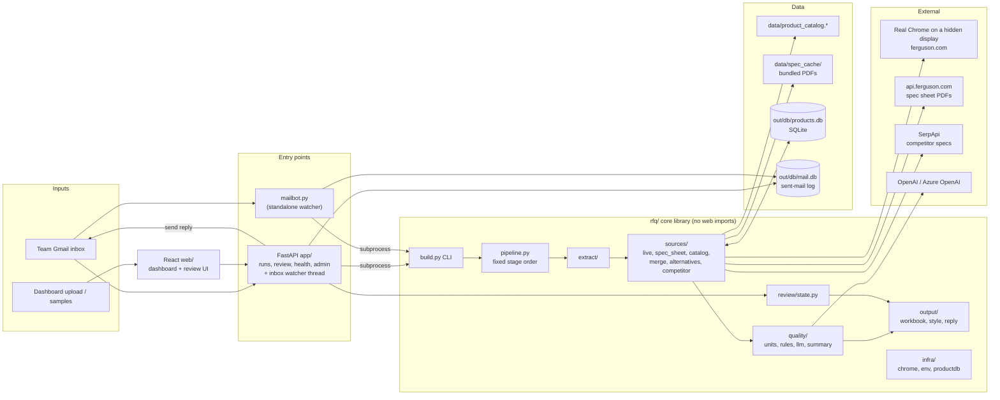
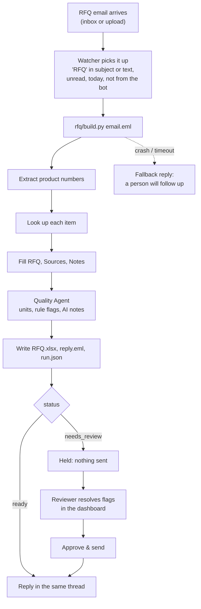
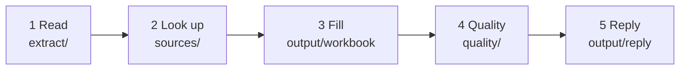
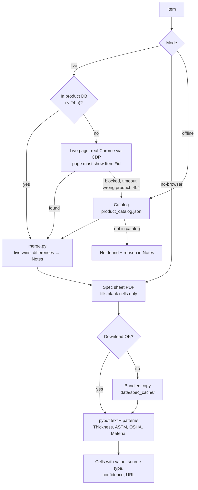
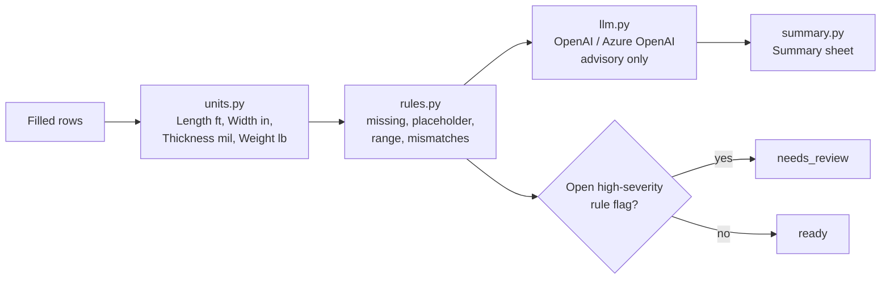
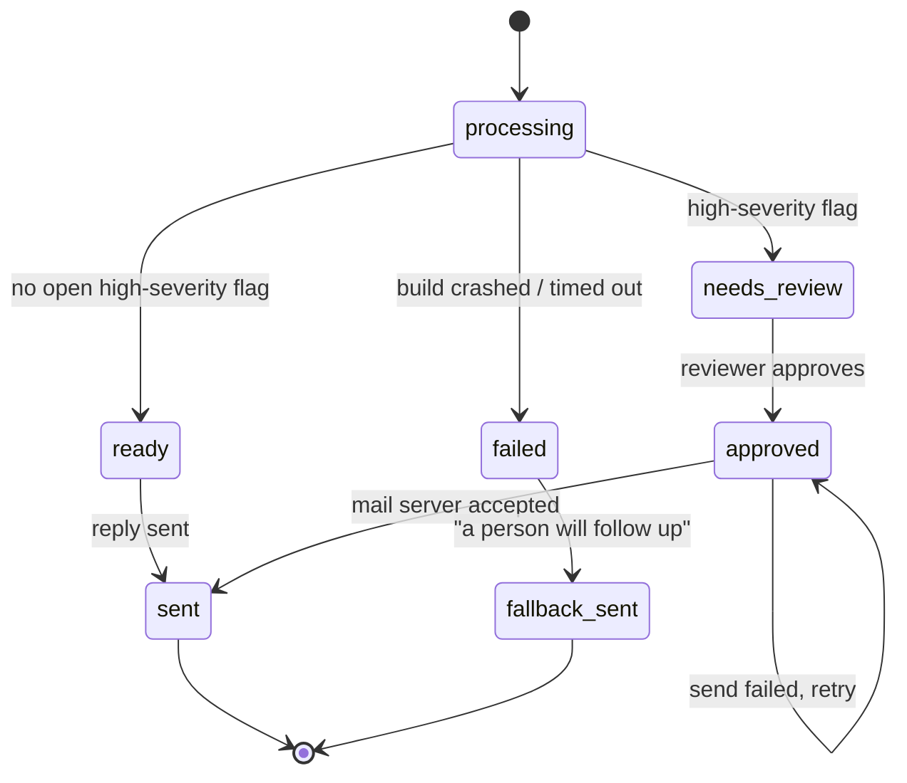
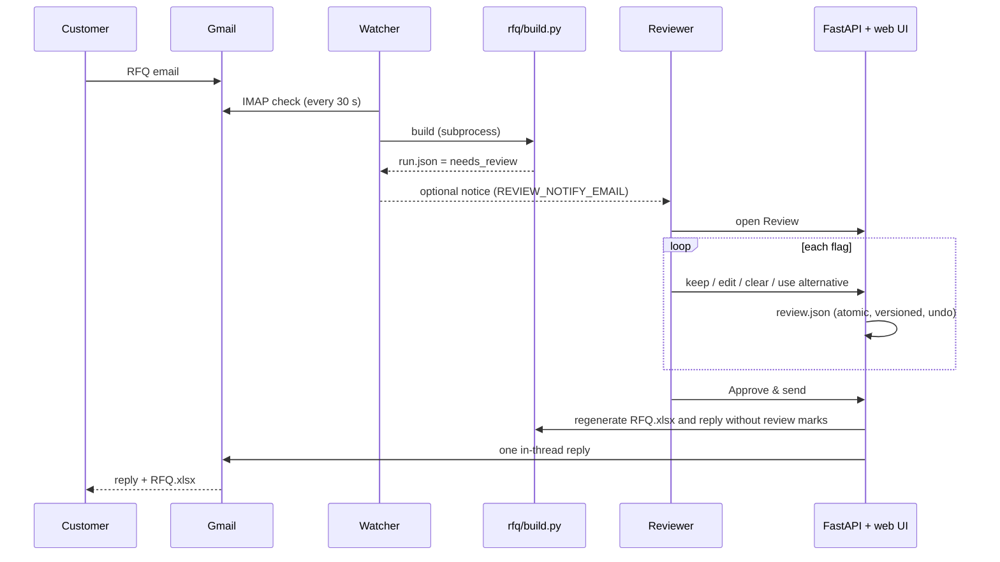
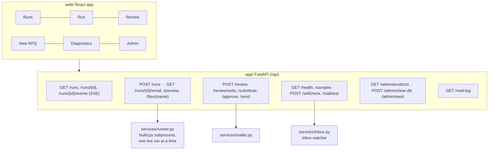
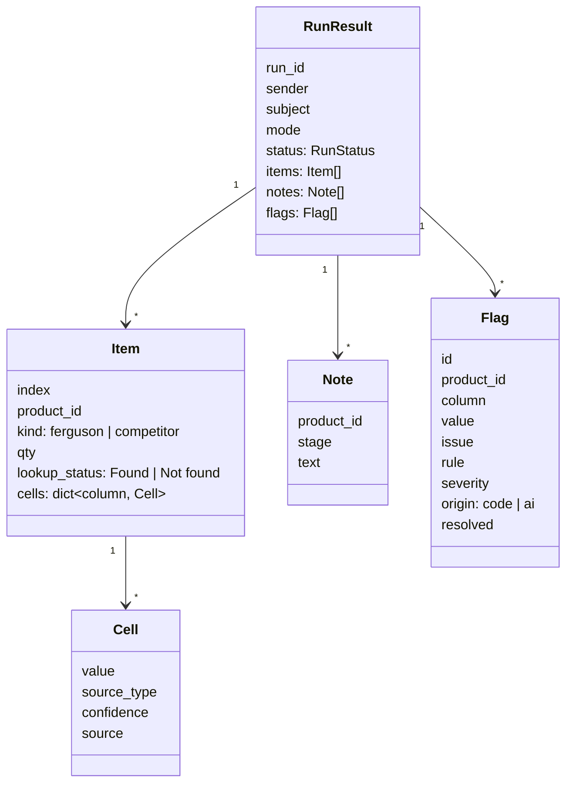
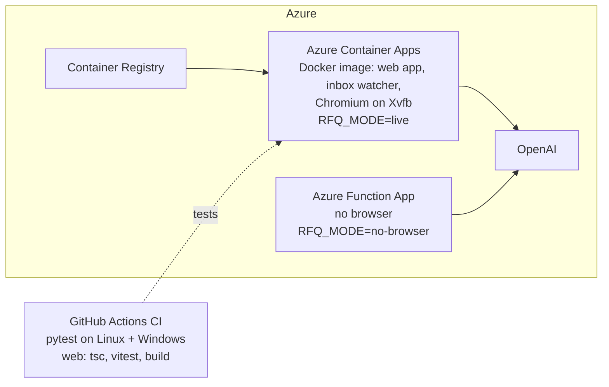

# AutoRFQ: how it works

How a sourcing email becomes a filled, checked RFQ: the problem, the flow, every stage, the Quality Agent,
the dashboard, the Azure deployment and how correctness is checked. For setup and commands, see the
[README](README.md).

**Contents:** [1 The problem and the answer](#1-the-problem-and-the-answer) ·
[2 Architecture](#2-architecture) · [3 One RFQ, end to end](#3-one-rfq-end-to-end) ·
[4 Pipeline stages](#4-pipeline-stages) · [5 Quality Agent](#5-quality-agent) ·
[6 Status and review](#6-status-and-review) · [7 Dashboard and API](#7-dashboard-and-api) ·
[8 Customer reply](#8-customer-reply) · [9 Failure handling](#9-failure-handling) ·
[10 Determinism](#10-determinism) · [11 Data model](#11-data-model) · [12 Deployment](#12-deployment) ·
[13 Configuration](#13-configuration) · [14 How correctness is checked](#14-how-correctness-is-checked)

---

## 1. The problem and the answer

Ferguson receives **RFQ (Request for Quote) emails**: a customer lists products and wants a price. Before
factories can quote, a sourcing manager turns the email into a complete RFQ sheet. Today that is manual:

| Step today | Cost |
|---|---|
| Read the email, attachments and forwards to find the product numbers | hours |
| Open ferguson.com for each product, one at a time | per product |
| Copy 23 details per product into the Excel template | most of the time |
| Hunt for missing details in maker spec sheets (PDFs) | per product |
| Fix units, look for typos, work out other brands' part numbers | hours |
| **Total** | **2 to 4 days per RFQ, about 40 RFQs a month across 6 countries** |

The requests are messy: product numbers hide in the body, in an Excel attachment, next to competitor part
numbers, or deep in a forwarded thread. The data is messy too: the same length written `1000`, `1000 ft` or
`333.33 yds`, placeholders instead of values, a "Sewer line" tape listed for water, items Ferguson no longer sells.

**AutoRFQ** reads the email, looks every product up, fills `templates/rfq_template.xlsx`, checks the result and
replies in the same thread, usually in about a minute. Each RFQ produces:

- **`RFQ.xlsx`** from Ferguson's template, one row per product, with these sheets:
  - **RFQ**: the 23 columns plus Lookup Status;
  - **Summary**: fill rate, quality flags, competitor cross-reference;
  - **Sources**: one row per filled value, saying where it came from;
  - **Notes**: what happened to each item and why.
- **`reply.eml`**: the answer in the customer's thread, with the workbook attached.
- **`run.json`** (status, counts, flags) plus `events.jsonl` and `run.log` for the dashboard and debugging.
- A row in the **mail log** for every email sent (section 6.1).

Three rules shape everything:

1. **Same email in, same Excel out.** The base is deterministic; AI only adds advisory notes.
2. **A blank beats a guess.** Unknown stays empty and is reported; every filled value has a source.
3. **The agent flags, it never overwrites.** Doubtful RFQs wait for a person.

---

## 2. Architecture



| Layer | Folder | Responsibility |
|---|---|---|
| Core library | `rfq/` | Email → `RunResult` → files. Knows nothing about the web. |
| CLI | `rfq/build.py`, `rfq/chrome.py` | Fixed command-line contract used by the app, `mailbot.py` and the checks. |
| Email bot | `mailbot.py` | Watches Gmail, runs a build per RFQ email, sends or holds the reply. Also runs inside the web app. |
| API | `app/` | FastAPI JSON API, SSE progress, review actions, admin. Serves `web/dist`. |
| Frontend | `web/` | React + Vite + TypeScript + Tailwind dashboard. |
| Tests | `tests/` | Offline unit and integration tests; CI on Linux and Windows. |

Builds always run as a **subprocess** (`rfq/build.py`), never inside the web server: browser automation stays
out of the event loop, a crash stays isolated, and there is one scraping Chrome, so live runs take turns.

---

## 3. One RFQ, end to end



The email is marked read **before** it is processed, so a bad email is never retried in a loop and a second
watcher never answers it twice.

---

## 4. Pipeline stages



Each stage writes progress events to `events.jsonl`; the dashboard stepper follows them over SSE.

### 4.1 Reading the email (`rfq/extract/`)

- **Text sources:** every `text/plain` part (HTML stripped as a fallback), forwarded `message/rfc822` emails,
  and `.xlsx` / `.xlsm` / `.csv` attachments. In a sheet, the column headed like `item|product|sku|part|id` is
  used; with no such header, any cell that looks like an ID.
- **Quoted replies** are stripped so a thread does not repeat its own list (with a fallback if nothing is left).
- **Ferguson IDs:** 5 to 7 digits, e.g. `#5106926` or `1844552 , 4783795`; `x 40 rolls` is ignored.
- **Competitor codes:** hyphenated alphanumeric tokens such as `17783-79-3000`, `31-024`, `MTX-4409-XQ`. They are
  never dropped: they become rows with their own lookup (4.3).
- **Non-products are filtered by context:** a number after `tel / phone / fax / zip / pin / po / order / invoice / qty`,
  line numbers and quantities in attachments.
- **Order and duplicates:** IDs keep their first-appearance order; a repeat is kept once with a Note.
- **Limits:** 300 items, 10 MB per attachment, 5,000 rows per sheet. `.xls`, protected or corrupt files get a
  Note asking the sender to resend.

### 4.2 Looking up each product (`rfq/sources/`)



| Source | `source_type` | Confidence | Notes |
|---|---|---|---|
| Live ferguson.com page | `ferguson_page` | high | Several tabs in parallel, re-sorted into email order. Time-boxed; stops after 3 blocks in a row. |
| Spec sheet PDF | `spec_sheet` | medium | Fills blanks only; keeps the page number and text snippet. |
| Catalog (56 products, 24 Sep 2026) | as given in the CSV | as given | Always available; used by `--offline` and as the fallback. |
| Product database | the original source | as stored | Reused for 24 h so repeat products are instant. |
| Human reviewer | `human_review` | high | Recorded with reviewer name and time. |

**The scraping browser.** ferguson.com refuses headless and scripted browsers. Live mode therefore attaches to
a **real, headed Chrome that stays hidden**: on Linux it runs on an invisible virtual display (Xvfb), on
Windows and macOS the window opens off-screen. No fingerprint tricks. The pipeline opens it when a live run
needs it and **closes it when the work is done** (`--keep-browser` keeps it; `RFQ_SHOW_BROWSER=1` shows it).
If the site refuses a page, that item falls back to the spec sheet and catalog with a Note.

### 4.3 Other brands' part numbers: the Competitor Product Finder

A customer often sends what they buy today (`Mutual 17783-79-3000`). The finder:

1. takes the description from the catalog's "not in catalog" sheet, the email line it was on, or a web search
   for `<brand> <code>` (SerpApi; only when a key is set and not offline);
2. reduces it to attributes: colour, utility, detectable or not, width, length, tape kind. APWA colours tie a
   utility to a colour (electric red, gas yellow, water blue, sewer green, telecom orange, reclaimed purple,
   force main brown);
3. scores catalog products on the same attributes (a colour or kind conflict rules a product out), ranked
   deterministically: score, then product ID;
4. labels each suggestion **strong match**, **possible match** or **confirmed**, and shows the competitor's specs
   with their source URLs (units normalised, e.g. 333.33 yds → 1000 ft).

Suggestions are **never put on the RFQ by themselves**. The reply offers them (`Reply "use 5106914"`); in the
dashboard, **Use instead** substitutes the Ferguson product and stores the cross-reference (kept 30 days).

### 4.4 The product database (`rfq/infra/productdb.py`)

A SQLite file (`out/db/products.db`) with two tables: `products` (scraped values with their sources; reused for
24 h, `RFQ_DB_TTL_HOURS`) and `crossrefs` (competitor code → Ferguson product). It is shared by every run, so
the second RFQ that mentions a product is instant. The **Admin** page lists it and has a **Clear DB** button
(`ADMIN_TOKEN`).

### 4.5 Run modes

| Mode | Flag | Sources used | Use |
|---|---|---|---|
| Live (default) | none | product DB → live page → spec PDF → catalog | the real thing |
| No browser | `--no-browser` | spec PDF (bundled fallback) → catalog | Azure Functions, servers without Chrome |
| Offline | `--offline` | catalog only, no network | tests; reproduces the reference exactly |
| Replay | `--replay` | cached pages and PDFs from `out/.cache/` | demo with bad Wi-Fi or a blocked site |
| No quality | `--no-quality` | skips the Quality Agent | debugging |

### 4.6 The workbook (`rfq/output/`)

- **RFQ sheet:** one row per item in email order; values are strings; `Image` is the formula `=IMAGE("url")`,
  `Picture` is the URL; `Lookup Status` is `Found` or `Not found`. A Not found row holds only the product ID and
  status.
- **Sources sheet:** one row per filled cell, in template column order.
- **Notes sheet:** `product_id | note`, sorted by item, then stage.
- **Summary sheet:** KPIs, fill rate per column, request lines with quantities, risk alerts, the flags table, AI
  suggestions and the competitor cross-reference table.
- **Styling is formatting only, never a value change:** branded header, frozen panes, autofilter, flagged cells
  in grey (missing), amber (rule flag) or orange (model flag) with a comment saying why.
- **Safety:** text starting with `=` stays text; illegal characters are stripped; the file is saved atomically
  with a retry if Excel has it open.

---

## 5. Quality Agent



**By code (decides the status):**

| Rule | Severity | Example |
|---|---|---|
| `missing` | low | a column no source filled: left blank, marked grey |
| `placeholder` | medium | `-` instead of a value |
| `not_numeric` | medium | a Length that is not a plain measurement |
| `application_mismatch` | medium | a tape printed "Sewer line" listed for Water (APWA colour and utility) |
| `out_of_range` | **high** | a value outside what the column can be |
| `description_mismatch` | **high** | the description says 300 ft, the Length says 300 in |
| `not_found` | n/a | listed in Notes and the reply, not a flag |

**Units, with no quiet fixes.** A bare `1000` becomes `1000 ft`; a value in another unit is converted (e.g.
yards to feet). Every change is a Note and the Sources row records "unit added" or "converted". A value that
does not fit (`300 in` on a tape sold as 300 ft) is **kept as is and flagged**, never silently "fixed".

**LLM check (advisory):** one call per found row with only that row's data and sources (never the raw email, so
text hidden in an email cannot reach the model).
- The model must quote the cell it questions and what it conflicts with; **code verifies the claim**, and
  hedged or unverifiable claims are dropped.
- Model flags are **capped at medium**: they appear on the Summary sheet and as orange cells, but never hold an
  RFQ and never change a value.
- With no key, or if the call fails, the check is skipped and the Summary says so; rule flags still run.

---

## 6. Status and review



A held RFQ sends **nothing** to the customer. Inbox RFQs are answered in their own thread; uploaded RFQs have no
thread, so they are sent to an address you choose (**Email RFQ…**). `run.json` records every send in `sent_to`.



### 6.1 Where files go, and the log of sent mail

```text
out/                      (RFQ_OUT_DIR)
  runs/<run id>/          RFQ.xlsx, reply.eml, run.json, run.log, events.jsonl, review.json
  inbox/                  emails received by the bot (.eml)
  uploads/                emails uploaded in the dashboard (.eml)
  db/products.db          product cache and cross-references (Admin can clear it)
  db/mail.db              the log of sent emails (never cleared)
  .cache/                 saved pages and PDFs for --replay
```

Every send goes through one function (`mailbot.send`), which writes a row to the **mail log** whether the mail
server accepted the message or not. A row holds: when, run, **kind** (`reply` in the customer's thread,
`rfq_email` to an address chosen in the dashboard, `fallback` "a person will follow up", `review_notice`),
recipient, subject, attachments, message and thread IDs, **sent / failed with the error**, and who sent it (web
app, `mailbot.py`, Azure timer or dashboard). It lives in its own SQLite file, so **Clear DB never touches it**
and a failed or repeated send can always be traced. The **Sent mail** page lists it with filters, and each run
has a Sent mail tab. A logging error never blocks a reply.

An older flat `out/` is moved into this layout when the app or the bot starts, and sends that older versions
kept in `run.json` are imported once.

**Review page:** flags grouped by item, high severity first, with a "3 of 7 resolved" line. Actions: keep the
value, edit it, clear it (unknown), or substitute a Ferguson alternative. An edit or clear adds a
`human_review` Sources row. Keyboard: ↑/↓ move, Enter keep, E edit, Del clear, Ctrl+Z undo. **Approve & send**
stays disabled until every high-severity flag is resolved, and says why.

---

## 7. Dashboard and API

| Page | What it is |
|---|---|
| **Runs** | every RFQ, from the inbox or uploaded, with status, found/flagged counts and a fill ring |
| **Run** | item cards with sources, Agent findings, Notes & flags tab, reply preview, **Send reply** / **Approve & send**, **Email RFQ…** |
| **Review** | the keyboard review above |
| **New RFQ** | upload an `.eml` or try one of the four samples; choose live, no-browser or offline |
| **Diagnostics** | which settings are on (never their values), mail login test, who watches the inbox and when it last checked, self-check |
| **Sent mail** | the mail log: every email sent, filter by result and type, link to its run |
| **Admin** | the product database, Clear DB |
| **/rfq** | a plain upload page served by the same app |



- **Health bar:** Chrome, LLM check, Inbox (Watching / Off) and Mail, always visible.
- **Design:** dark theme by default with a light option; Ferguson palette (provisional, since the Brand Connect
  guidelines need a login); every status has an icon **and** text; short fades, reduced motion respected;
  keyboard access throughout.
- **Inbox watcher:** with the mail keys set, the app checks the inbox every 30 s in a background thread
  (`RFQ_INBOX_WATCH=0` turns it off). If a separate `mailbot.py` is alive, the app leaves the inbox to it; on
  Azure Functions a timer function does the check instead. Each check writes a heartbeat that Diagnostics shows.

---

## 8. Customer reply

Multipart (HTML + plain text) with `RFQ.xlsx` attached, in buyer wording:

- a summary line: "Your RFQ for 7 items is attached: 5 matched, 2 need your input.";
- a counts line: "Products found: 5 of 7. Not found: 2.";
- an item table: #, Item, Description, Status, Unit price, Availability;
- "Items we couldn't match", each with a reason and a next step. A competitor code gets "A possible Ferguson
  match: 9677539 (3 in. x 1000 ft. Marking Tape in Red)" and `Reply "use 5106914"`;
- a quality line: "Quality check: every value checked. 3 measurements converted to standard units. 2 values
  are worth a second look; they are listed on the Summary sheet." (or "No issues found."; after a review:
  "checked by our team.");
- "Every value's source is on the Sources sheet."

It **never** contains internal words (flag, severity, rule), fill rates, review links, "AI" or "DRAFT".

---

## 9. Failure handling

Principle: **a bad input or a broken source makes the RFQ smaller; it never makes the run fail.**

| Problem | What happens |
|---|---|
| Bad or unreadable attachment | skipped, Note, the rest continues |
| Browser missing or down | probed once at the start, run continues in no-browser mode, one warning |
| Page blocked, timeout, wrong product, 404 | catalog fallback + Note; live lookups stop after 3 blocks in a row |
| Spec sheet download fails | bundled copy, else skipped + Note |
| LLM fails or no key | skipped; rule flags still run |
| Build crashes or times out (inbox) | sender gets "a person will follow up"; the email is already marked read |
| Mail server rejects the reply | status stays `approved`; Send can be retried |

| Exit code | Meaning |
|---|---|
| `0` | `RFQ.xlsx` and `reply.eml` were written, possibly with warnings |
| `1` | the kit itself is broken (template or catalog missing); nothing could be written (`error.txt`) |
| `2` | usage error: missing `.eml` or bad flags |

Problems are recorded in three places: the **Notes** sheet (the buyer sees it), **`run.log`** (warnings and
tracebacks) and the printed summary line (`warnings: N`). The bot wraps every email in try / except and sends
a follow-up on failure, so one bad email can never block the inbox.

---

## 10. Determinism

| Rule | How |
|---|---|
| AI is advisory | status, highlights and reply wording come from code rules only |
| Stable order | parallel lookups are re-sorted into email order; Notes sorted by item, then stage |
| Repeatable fallback | bundled spec PDFs and the catalog make `--offline` / `--no-browser` repeatable |
| No timings in outputs | timings appear only in the dashboard, console and `run.log` |
| Values, not bytes | tests compare cell values; openpyxl timestamps may differ |
| Human edits | the only change allowed after the build, recorded as a `human_review` source |

---

## 11. Data model



Statuses: `processing`, `ready`, `needs_review`, `approved`, `sent`, `failed`, `fallback_sent`. The same model is
used by every stage, by `run.json` and by the API.

---

## 12. Deployment



| Target | What runs | Mode | Notes |
|---|---|---|---|
| **Container Apps** (`--target container`) | the `Dockerfile`: web app, inbox watcher, Chromium on Xvfb | `live` | one always-on replica (1 vCPU, 2 GiB); the main deployment |
| **Function App** (default) | `function_app.py` wraps FastAPI; `host.json` sets `routePrefix ""` | `no-browser` | no browser possible; an `inbox_timer` function can check the inbox every minute |
| App Service (`--target webapp`) | the same code | `no-browser` | alternative |

- `scripts/deploy_azure.py --with-secrets` copies the keys from `.env` into app settings or container secrets
  and ends with the email-1 self-check against the live URL.
- Use `--no-inbox` on the second deployment, so only one of them answers the inbox.
- Only `/tmp` (Functions) or `/data` (container) is writable, so the product database and outputs there are
  ephemeral.
- Cross-platform: `pathlib` paths from the repo root, explicit UTF-8 everywhere, Windows-safe folder names,
  atomic Excel saves, and a Chrome / Edge / Chromium launcher in `rfq/infra/chrome.py`.

---

## 13. Configuration

One loader (`rfq/infra/env.py`) feeds `.env` to `build.py`, `mailbot.py` and the web app; Diagnostics shows
which keys are set, never their values. See `.env.example`.

| Setting | Purpose |
|---|---|
| `BOT_EMAIL`, `BOT_PASSWORD` | the team Gmail and its App Password (read the inbox, send replies) |
| `OPENAI_API_KEY`, `OPENAI_MODEL` (or `AZURE_OPENAI_*`) | the LLM check |
| `SERPAPI_API_KEY` | competitor specs from the web |
| `REVIEW_NOTIFY_EMAIL`, `DASHBOARD_URL` | "needs review" notice and its link |
| `RFQ_MODE` | force `live`, `no-browser` or `offline` (set on Azure) |
| `RFQ_OUT_DIR`, `RFQ_PRODUCTS_DB`, `RFQ_MAIL_DB`, `RFQ_DB_TTL_HOURS` | where runs and the two databases live; reuse window |
| `RFQ_AUTO_BROWSER`, `RFQ_SHOW_BROWSER`, `RFQ_CDP` | open and close the scraping Chrome; show it; its address |
| `RFQ_INBOX_WATCH` | `0` turns the in-app inbox watcher off |
| `ADMIN_TOKEN` | protects the Admin endpoints |

---

## 14. How correctness is checked

- **Reference match:** email 1 built offline equals `reference/email-1 reference output.xlsx` cell for cell
  (6 rows, 105 Sources rows, status Ready), including the RFQ sheet's formula/text types.
- **Extraction:** the four expected ID lists; unknown and competitor items show as Not found and are never
  dropped; duplicates kept once.
- **Quality:** the deck cases (the Application/Lettering clash in email 1, bare numbers in email 2), units
  with no quiet fixes, and the LLM staying advisory (claims verified by code, flags capped at medium).
- **Review and send:** decisions, undo, the hold → approve → reply path, send rules (held and uploaded RFQs
  refused), the inbox watcher's search and read-first behaviour, and the mail log (sent and failed rows, filters,
  one-time import, layout migration).
- **Failures and determinism:** broken-input fixtures, exit codes, repeatable output.
- **Web:** vitest unit tests; the API is covered by integration tests.
- **Acceptance script:** `python .claude/skills/rfq-verify/check.py --build` rebuilds the four samples and
  re-checks all of the above; CI runs it on every push (Ubuntu, Windows, and Python 3.10 as the lowest version).
- **Live check:** the **Self-check** on Diagnostics runs email 1 on the running server and compares it with the
  reference, which is also how each Azure deployment is verified.
